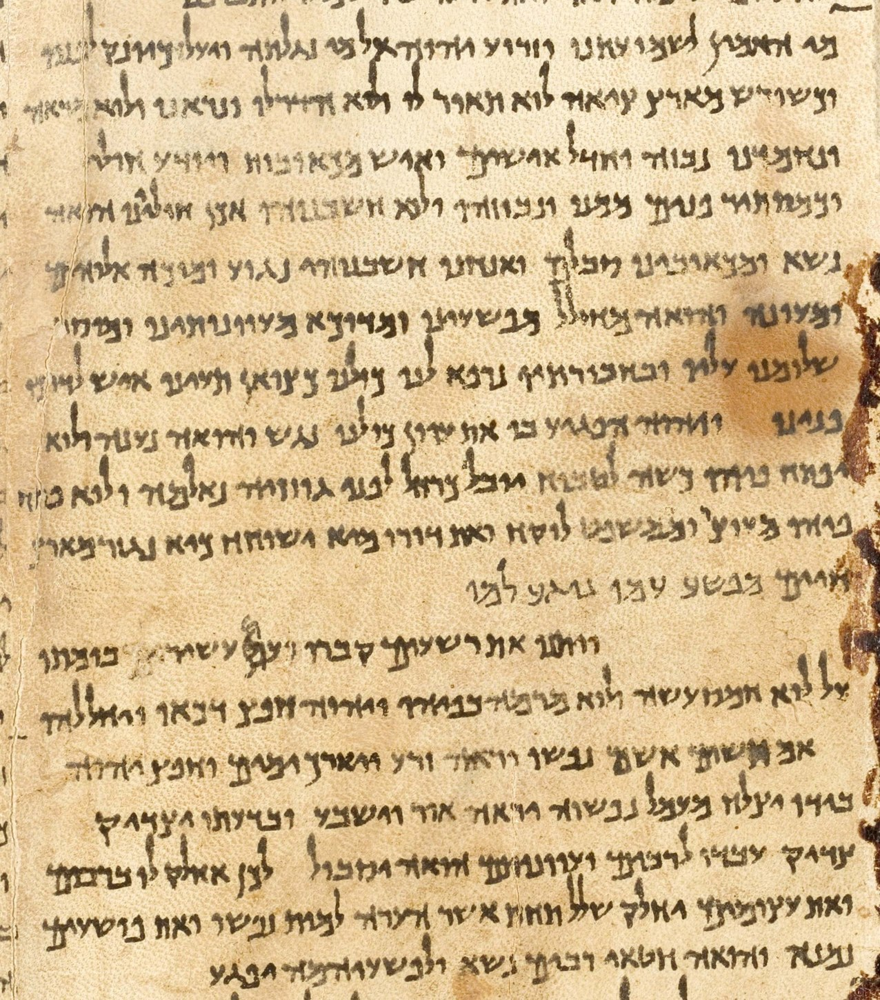

# Is Jesus of Nazareth the promised Messiah?

A four-phase investigation from Israel’s Scriptures to the earliest resurrection testimony. **Astra’s assessment is yes, on balance.** The case turns on whether Yahweh raised this particular claimant and thereby vindicated his royal vocation. The possibility of sincere error and the outstanding promises of peace and Israel’s restoration explain why the verdict falls short of certainty. [Read the findings](FINDINGS.md).

*Isaiah 53 in the Great Isaiah Scroll. This manuscript predates Christianity. It establishes the antiquity of the passage and leaves the identity of its servant open to interpretation. Image by Ardon Bar Hama / Israel Museum.* [Image credits](visuals/CREDITS.md)

## Pick a starting point

- **For a visual introduction**, open the [six-page visual field guide](pdfs/visual-field-guide.pdf). Each image has a question and an answer. For the interactive version, extract the repository and open [the offline gallery](visuals/index.html) in a browser.
- **For the whole argument**, read the [45-slide presentation](pdfs/reading-presentation.pdf). Slide 35 asks why a resurrection would identify Jesus specifically as king. Slide 41 gives the verdict. The [searchable text edition](presentation/PRESENTATION.md) includes the probability table, image credits and source links.
- **For the full investigation**, open the [70-page reconciled volume](pdfs/complete-investigation.pdf). Pages 1–5 explain the two hardest objections. The academic paper starts on page 9, the amended debate on page 31, and the independent assessment on page 63.
- **To test the argument**, compare the [findings and remaining objections](FINDINGS.md) with the texts in the [research bibliography](SOURCES.md).

## The PDF collection

| Document | Pages | What it contributes |
| --- | ---: | --- |
| [Phase 1 · Executive summary](pdfs/01-executive-summary.pdf) | 3 | The thesis, the strongest difficulties, and the standard of evidence. |
| [Phase 2 · Structured academic paper](pdfs/02-academic-paper.pdf) | 22 | Scriptural interpretation, Second Temple expectations, ancient sources, archaeology, and the Bayesian comparison. |
| [Phase 3 · Original debate](pdfs/03-debate-original.pdf) | 24 | The initial exchange with the Rabbinic Critic, Secular Historian, Islamic Theologian, and Comparative Mythicist. |
| [Phase 3 · Amended debate](pdfs/03-debate-amended.pdf) | 32 | The affirmative argument, direct rebuttals to each panel, and the advocate’s closing statement. |
| [Phase 4 · Independent assessment](pdfs/04-independent-assessment.pdf) | 8 | The final judgment, its assumptions, and the evidence that could change it. |
| [Reconciled investigation](pdfs/complete-investigation.pdf) | 70 | The four phases, with the amended debate, linked contents, and a reconciliation of their conclusions. |
| [The evidence and the verdict](pdfs/reading-presentation.pdf) | 45 | An illustrated reading presentation with linked sources and historical image captions. |
| [Visual field guide](pdfs/visual-field-guide.pdf) | 6 | A new companion to six places, objects and works of art, with close-looking questions and sources. |

The original debate was reconstructed from its retained text and layout. All 24 rendered pages matched the saved original page previews pixel for pixel. The amended edition is the debate used in the reconciled volume. The four-phase page counts overlap with the combined volume.

## The visual collection

The gallery distinguishes the date of an event, the date of a surviving manuscript, and the date of a modern photograph. Papyrus 46, for example, is a later copy of a letter Paul wrote in the 50s CE. The particular leaf pictured contains 1 Corinthians 2:11–3:5. Caravaggio’s image of Thomas records how a later artist imagined John 20. Each image has its own source and reuse information. [Gallery](visuals/index.html) · [Image credits and reuse terms](visuals/CREDITS.md)

## Using the archive

Extract the entire folder before opening the gallery so its photographs load from the adjacent image directory. The PDFs, Markdown and photographs can be read offline. External sources require internet access. The extracted folder is a Git working copy on the `main` branch. Run `git log --oneline` inside it to inspect its history.
